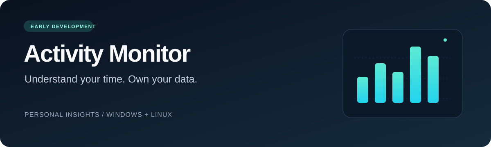

<p align="center">
  
</p>

# STime NOW

[Português](README.md) · **English**

Desktop screen-time management for personal focus, families, and teams, developed as a Software Engineering course project.

The first desktop increment provides a visitor dashboard with active/idle totals, usage charts, application filters, date ranges, and an English/Portuguese interface. It runs with **sample activity only**. Live monitoring, app suspension, accounts, and family/team workflows are upcoming increments.

## Start the desktop app

Requires Git, Python 3.11+, and Tk. The desktop extra installs pandas and matplotlib.

```bash
git clone https://github.com/muhh190106/app-monitoramento-linux.git
cd app-monitoramento-linux
```

**Windows · PowerShell**

```powershell
python -m venv .venv
.\.venv\Scripts\python.exe -m pip install -e ".[desktop]"
.\.venv\Scripts\python.exe -m activity_monitor --desktop
```

After setup, double-click `start-windows.cmd` to reopen the dashboard.

**Linux · Bash**

```bash
python3 -m venv .venv
.venv/bin/python -m pip install -e '.[desktop]'
.venv/bin/python -m activity_monitor --desktop
```

Install your distribution's Tk package if `tkinter` is unavailable. Desktop mode requires a graphical session. Add `--language pt-BR` to start in Portuguese, or switch languages from the dashboard.

The lightweight CLI demo remains available through `python -m activity_monitor --demo` without the desktop extra.

## Database

The SQLite layer includes migrations, event storage, daily/weekly/monthly reports, and history maintenance. See the [storage guide](docs/storage.md) (Portuguese). The dashboard still uses in-memory sample data; API integration is the next step.

## Product direction

- **Personal focus:** usage insights and app suspension during focus sessions.
- **Families:** family codes, screen-time limits, and temporary access requests.
- **Teams:** membership, application categories, and daily reports.

The [increment plan](docs/roadmap.md) defines the next steps and acceptance criteria. See the [product specification](docs/product.md) for the full planned scope.

## Documentation

Joining the team? Start with the [developer onboarding guide](docs/team.md) (Portuguese), covering the five workstreams and their first deliverables.

Project requirements, architecture and team documentation are maintained in Portuguese for the Software Engineering course. Code, API fields, endpoints and commit messages use English; the interface supports English and Brazilian Portuguese. Contributions and discussions are welcome in either language.

[Architecture](docs/architecture.md) · [API](docs/api.md) · [Data model](docs/data-model.md) · [Development](docs/development.md) · [Contributing](CONTRIBUTING.md) · [Security](SECURITY.md)

Inspired by [ActivityWatch](https://github.com/ActivityWatch/activitywatch). STime NOW is an independent project; no ActivityWatch source code is included.
