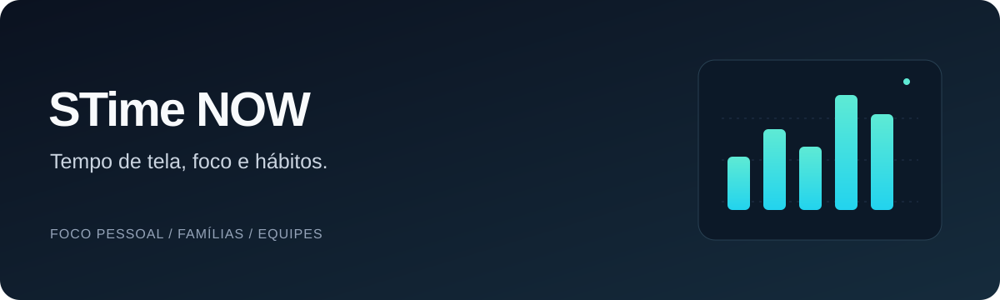

<p align="center">
  
</p>

# STime NOW

**Português** · [English](README.en.md)

Aplicativo desktop de gestão do tempo de tela para foco pessoal, famílias e equipes, desenvolvido como trabalho de Engenharia de Software.

O primeiro incremento oferece um painel de visitante com totais de uso e inatividade, gráficos, filtros por aplicativo e período e interface em português/inglês. Ele utiliza **somente dados fictícios**. Coleta real, bloqueio de aplicativos, contas e recursos de famílias/equipes estão previstos para os próximos incrementos.

## Executar o aplicativo

Requer Git, Python 3.11+ e Tk. A instalação com a opção `desktop` inclui pandas e matplotlib.

```bash
git clone https://github.com/muhh190106/app-monitoramento-linux.git
cd app-monitoramento-linux
```

**Windows · PowerShell**

```powershell
python -m venv .venv
.\.venv\Scripts\python.exe -m pip install -e ".[desktop]"
.\.venv\Scripts\python.exe -m activity_monitor --desktop --language pt-BR
```

Após a configuração, dê dois cliques em `start-windows.cmd` para reabrir o painel. O idioma também pode ser alterado na interface.

**Linux · Bash**

```bash
python3 -m venv .venv
.venv/bin/python -m pip install -e '.[desktop]'
.venv/bin/python -m activity_monitor --desktop --language pt-BR
```

Instale o pacote Tk da sua distribuição se `tkinter` não estiver disponível. O modo desktop exige uma sessão gráfica. Use `--language en` para iniciar em inglês.

A demonstração pelo terminal continua disponível com `python -m activity_monitor --demo`, sem as dependências do painel.

## Direção do produto

- **Foco pessoal:** acompanhamento do uso e restrições durante sessões de foco.
- **Famílias:** códigos de ingresso, limites de tempo e pedidos de acesso temporário.
- **Equipes:** participação, categorias de aplicativos e relatórios diários.

O [planejamento](docs/roadmap.md) apresenta as próximas entregas e seus critérios de conclusão. Os [requisitos](docs/product.md) descrevem o escopo completo previsto.

## Documentação

[Arquitetura](docs/architecture.md) · [API](docs/api.md) · [Modelo de dados e DER](docs/data-model.md) · [Desenvolvimento](docs/development.md) · [Contribuição](CONTRIBUTING.md) · [Segurança](SECURITY.md)

A documentação principal está em português para apoiar a equipe e a avaliação acadêmica. Código, campos e endpoints permanecem em inglês; a interface oferece os dois idiomas.

Inspirado no [ActivityWatch](https://github.com/ActivityWatch/activitywatch). STime NOW é um projeto independente e não inclui código-fonte do ActivityWatch.
