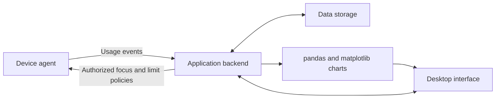

# Architecture

STime NOW is planned as a desktop application with an installed device agent and an application backend. The agent monitors usage and applies authorized suspension policies; the backend owns account, family, team, policy, and reporting workflows.

The aggregation core, CLI demo, and a visitor desktop dashboard with synthetic data are implemented. The following diagram describes the target architecture, not running services.



## Component boundaries

**Device agent:** Windows/Linux capability detection, permission-aware collection, idle state, and application suspension/restoration. Desktop session support and enforcement semantics must be defined before implementation.

**Application backend:** authentication, role selection, scoped authorization, family/team codes, membership, policy changes, temporary access decisions, and report closure. Network communication uses HTTPS. Local versus hosted deployment is still an architectural decision.

**Data storage:** usage intervals, accounts, memberships, policies, audit records, requests, explanations, and reports. SQLite is an earlier candidate for local data; the full storage design is not selected yet.

**Desktop interface:** role-specific dashboards, day/week/month filters, focus controls, family limits, request review, and team reports. Charts use pandas and matplotlib as required by the product specification. Layouts must adapt to screen size, support English/Portuguese, and account for accessibility.

## Current event contract

`activity_monitor.summary.summarize` accepts normalized, non-overlapping intervals:

```python
{"app": "Editor", "seconds": 120, "afk": False}
```

| Field | Type | Meaning |
| --- | --- | --- |
| `app` | Non-empty string | Application identifier or display name |
| `seconds` | Finite, non-negative number | Interval duration |
| `afk` | Boolean | Whether the interval represents idle time |

The function returns active seconds grouped by application. Invalid values raise `ValueError`; missing fields raise `KeyError`. Timestamps, overlaps, devices, sessions, authentication, storage, and policy enforcement are not part of the current core.

## Data and authorization

Visitor access is local to the user's own usage. Guardian access is scoped to linked children; manager access to the managed team. Team members view only their own records. Device trust, data retention, sharing, and revocation must be specified before enabling these workflows.

Use synthetic fixtures in development, CI, and cloud workspaces. Activity data does not belong in Git. Code synchronization through GitHub is independent of the product's future agent/backend data exchange.

## Technical names

The product name is **STime NOW**. The repository URL, `activity_monitor` Python package, and `activity-monitor` CLI retain their existing names. The `monitoramento` package remains a compatibility entry point for existing environments.

## First desktop slice

`desktop.py` depends on a reporting interface rather than platform collection APIs. `reporting.py` clips typed intervals into period buckets and uses pandas to derive totals; `charts.py` turns the report into a matplotlib figure. The current provider generates deterministic sample data. The next increment will introduce local storage behind this boundary.

Tkinter supplies the initial desktop shell. This is a starting toolkit decision for the visitor slice, not a commitment to the final account/backend topology. Full accessibility and platform coverage require dedicated follow-up checks.
