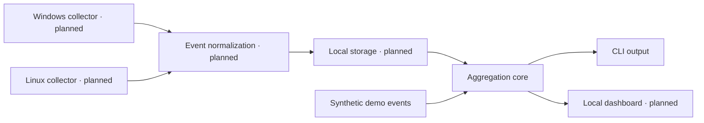

# Architecture

Activity Monitor separates portable activity logic from operating system integration. The current repository implements the aggregation core and CLI demo. The remaining components below are planned.



## Current event contract

`activity_monitor.summary.summarize` accepts an iterable of normalized, non-overlapping intervals:

```python
{"app": "Editor", "seconds": 120, "afk": False}
```

| Field | Type | Meaning |
| --- | --- | --- |
| `app` | non-empty string | Application identifier or display name |
| `seconds` | finite, non-negative number | Duration of the interval |
| `afk` | boolean | Whether the interval represents idle time |

The function returns active seconds grouped by application. It validates idle events too, rejects invalid values with `ValueError`, and raises `KeyError` for missing fields. It does not resolve overlapping intervals or distinguish timestamps, devices, and time zones yet.

## Planned boundaries

**Collectors:** platform-specific adapters that produce events only after the user enables collection. Windows and Linux integrations must have independent capability detection and tests. Linux implementation must account for X11/Wayland and compositor support.

**Normalization:** timestamp validation, idle detection semantics, interval boundaries, overlap handling, and device identity. This layer must be defined before adding real collection.

**Storage:** a local SQLite database outside the checkout, with migrations, retention, export, and deletion behavior defined before use.

**Presentation:** a local dashboard consuming aggregate data. It must communicate when collection is paused and expose data controls.

**Synchronization:** code moves through GitHub. Future activity synchronization is a separate, optional feature that requires its own threat model and conflict handling.

## Compatibility

`activity_monitor` is the canonical Python package and `activity-monitor` is the installable command. The original `monitoramento` package forwards to the same implementation so existing development environments can continue running.
