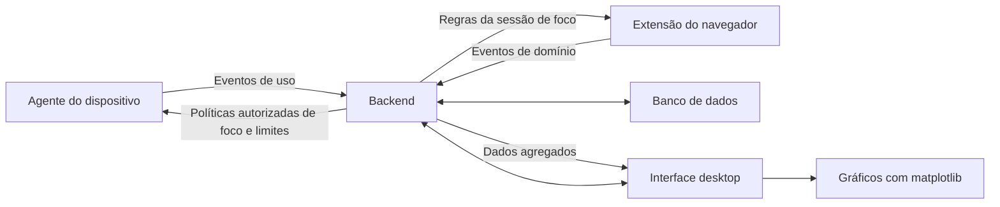

# Arquitetura

STime NOW é planejado como uma aplicação desktop com agente instalado e backend. O agente observa o uso e aplica restrições autorizadas; o backend concentra os fluxos de contas, famílias, equipes, políticas e relatórios.

O núcleo de agregação, a demonstração pelo terminal e o painel de visitante com dados fictícios já estão implementados. O diagrama representa a arquitetura desejada, não serviços em execução.



## Responsabilidades dos componentes

**Agente do dispositivo:** detectar recursos disponíveis no Windows/Linux, coletar com permissão, identificar inatividade e suspender/restaurar aplicativos. O suporte às sessões gráficas e as regras de aplicação das restrições precisam ser definidos antes da implementação.

**Backend:** na primeira integração, recebe e valida eventos, agrega o uso e controla o ciclo das sessões de foco pessoal. A base é um backend local por espaço pessoal, com tokens de cliente revogáveis. Autenticação hospedada, códigos de famílias/equipes, participação, acesso temporário e fechamento de relatórios são extensões futuras. Comunicação fora do endereço local exige HTTPS.

**Banco de dados:** SQLite foi escolhido para a primeira integração local, com arquivos fora do repositório. O [modelo de dados](data-model.md) define dispositivos, observações, metas e regras de foco. Contas, vínculos, políticas de responsáveis e relatórios de equipes exigem uma ampliação posterior.

**Interface desktop:** painéis por perfil, filtros de dia/semana/mês, controles de foco, limites familiares, análise de solicitações e relatórios de equipes. Os gráficos usam pandas e matplotlib conforme os requisitos. A interface deve se adaptar à tela, oferecer português/inglês e considerar acessibilidade.

## Interface atual da demonstração local

`activity_monitor.summary.summarize` recebe registros normalizados de duração; cabe ao chamador fornecer intervalos sem sobreposição:

```python
{"app": "Editor", "seconds": 120, "afk": False}
```

| Campo | Tipo | Significado |
| --- | --- | --- |
| `app` | Texto não vazio | Identificador ou nome exibido do aplicativo |
| `seconds` | Número finito e não negativo | Duração do intervalo |
| `afk` | Booleano | Indica se o intervalo representa inatividade |

A função retorna segundos ativos agrupados por aplicativo. Valores inválidos geram `ValueError`; campos ausentes geram `KeyError`. Esse utilitário não valida horários nem dispositivos e não é o contrato de recebimento da API. O módulo separado de relatórios do painel valida intervalos fictícios sem sobreposição, usando horários locais sem informação de fuso.

## Contratos de integração

O [contrato da API](api.md), o [documento OpenAPI](contracts/openapi.json) e o [modelo de entidades](data-model.md) definem a próxima etapa. São especificações, não serviços implementados. Na futura API, intervalos UTC substituirão os horários locais sem fuso. As observações do computador e do navegador permanecem separadas: o tempo do navegador é cruzado com o uso ativo do computador, não somado a ele.

Os relatórios do backend usam períodos de calendário e fusos IANA. A interface consome os resultados e desenha os gráficos sem recalcular as agregações.

## Dados e autorização

O visitante acessa localmente os próprios dados. Responsáveis acessam apenas filhos vinculados; gestores, a equipe administrada. Integrantes veem somente seus registros. Confiança dos dispositivos, retenção, compartilhamento e revogação precisam estar definidos antes de habilitar esses fluxos.

Use dados fictícios no desenvolvimento, na integração contínua (CI) e nos ambientes de nuvem. Históricos de atividade não pertencem ao Git. A sincronização de código pelo GitHub é independente da futura troca de dados entre agente e backend.

## Nomes e idiomas

O produto se chama **STime NOW**. A URL do repositório, o pacote Python `activity_monitor` e o comando `activity-monitor` mantêm seus nomes. O pacote `monitoramento` continua como entrada de compatibilidade.

Documentação e explicações dos diagramas ficam em português; código, entidades, campos e endpoints ficam em inglês. A interface mantém traduções em português brasileiro e inglês. O [README em inglês](../README.en.md) apresenta o projeto ao público internacional.

## Primeiro incremento desktop

`desktop.py` depende da camada de relatórios, não de APIs de coleta do sistema. `reporting.py` recorta intervalos tipados em faixas de tempo e usa pandas para calcular totais; `charts.py` transforma o relatório em um gráfico matplotlib. O provedor atual gera dados fictícios determinísticos.

O próximo incremento implementará o fluxo API/banco e um adaptador de API nessa fronteira. Ele deve tratar UTC e fusos explicitamente, sem remover essa informação para reutilizar os cálculos da demonstração.

Tkinter fornece a interface inicial do visitante. Essa escolha não fecha a arquitetura futura de contas e backend. Acessibilidade completa e cobertura de plataformas exigem verificações específicas posteriores.
