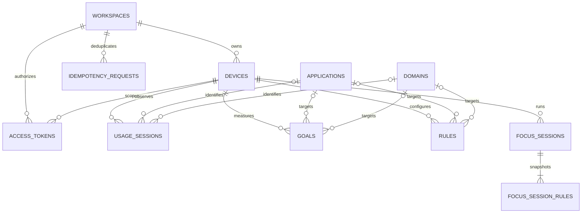

# Data model

Status: logical design v1 for personal usage, goals and focus. No database,
migrations or persistence layer has been implemented. This is the complete entity
map for the five-developer integration scope, not the complete family/team product.
See [API contract](api.md) for event and reporting semantics.

## Relationships

`rules` combines blocklist and allowlist entries through `action`; two tables
would duplicate the same target and ownership structure. `usage_sessions` stores
closed raw observation intervals, not an entire login session or a derived daily
total. Browser and desktop observations are separate rows.

## Entity dictionary

All IDs are UUID strings unless noted. `created_at` and other timestamps are UTC;
store epoch milliseconds as integers in the initial SQLite implementation. API
serialization converts them to/from UTC strings. Durations are derived from
timestamps, not independently writable. `?` denotes nullable fields; other fields
are required. Foreign keys are enforced on every connection.

| Entity | Fields and keys |
| --- | --- |
| `workspaces` | `id PK`, `name`, `timezone` (IANA), `retention_days` (initially 90), `created_at` |
| `devices` | `id PK`, `workspace_id FK`, `name`, `platform` (`windows`, `linux`), `ingestion_not_before` (UTC), `created_at`, `revoked_at?` |
| `access_tokens` | `id PK`, `workspace_id FK`, `device_id? FK`, `token_hash UNIQUE`, `client_kind` (`desktop_ui`, `desktop`, `browser`), `created_at`, `expires_at`, `revoked_at?` |
| `applications` | `id PK`, `app_key UNIQUE`, `display_name`, `platform` (`windows`, `linux`) |
| `domains` | `id PK`, `hostname UNIQUE` (canonical ASCII exact hostname) |
| `usage_sessions` | `id PK` (server UUID), `device_id FK`, `event_id`, `source`, `state`, `application_id? FK`, `domain_id? FK`, `started_at`, `ended_at`, `received_at`, `payload_hash`; `UNIQUE(device_id, event_id)` |
| `goals` | `id PK`, `device_id FK`, `target_type` (`all`, `application`, `domain`), `application_id? FK`, `domain_id? FK`, `period` (`day`, `week`, `month`), `timezone`, `limit_seconds` (>0), `created_at` |
| `rules` | `id PK`, `device_id FK`, `target_type` (`application`, `domain`), `application_id? FK`, `domain_id? FK`, `action` (`block`, `allow`), `created_at` |
| `focus_sessions` | `id PK`, `device_id FK`, `status` (`active`, `completed`, `cancelled`), `started_at`, `scheduled_end_at`, `finished_at?`, `created_at` |
| `focus_session_rules` | `id PK`, `focus_id FK`, `target_type`, `target_key`, `action`; `UNIQUE(focus_id, target_type, target_key)` |
| `idempotency_requests` | `workspace_id FK`, `route`, `key`, `request_hash`, `response_status`, `response_body`, `created_at`, `expires_at`; composite PK `(workspace_id, route, key)` |

Applications are keyed by platform identity, not display name. Two applications
with the same display label remain distinct. Display-name updates never change
event identity. Canonical payload hashes include the original normalized event
fields, including the supplied app label; mutable catalog labels do not alter
duplicate detection. App/domain IDs in rules and goals must resolve to known
catalog entries. Rule/goal creation uses API resource keys and resolves those IDs
transactionally. Application platform must match its device in observations,
goals and rules. Catalog entries may exist before observations.

Snapshot rows copy a rule's key and action at focus creation, rather than depending
on mutable/deletable rule rows. Each focus session requires at least one rule.
Editing/deleting source rules never weakens an already active session.

## Constraints and transactions

- `ended_at > started_at`; observations last at most 60000 ms. The backend enforces
  future tolerance, retention and hostname/time-zone validation before insertion.
- Active desktop rows require an application and no domain. Idle desktop rows
  have neither target. Browser rows require a domain, `state=active`, and no
  application. Source and state use closed enumerations.
- Goals require no target for `all`, only an application for `application`, and
  only a domain for `domain`. Rules use the latter two cases. Use `CHECK`
  constraints for target/null consistency as well as enum and positive limits.
- Agent/extension token device ownership must match token workspace ownership.
  Desktop UI tokens have no device scope; agent/browser tokens require one.
  Check ownership transactionally, not just the existence of each foreign key.
- For each `(device, source)`, the overlap predicate is
  `existing.started_at < incoming.ended_at AND existing.ended_at > incoming.started_at`.
  Check it for both persisted and incoming rows inside the same serialized write
  transaction as insertion (`BEGIN IMMEDIATE` for the initial SQLite adapter).
  A unique constraint alone cannot prevent overlapping intervals.
- Enforce at most one `active` focus per device with a partial unique index.
  Reconcile elapsed sessions inside the start transaction before testing it.
  Completed sessions finish at scheduled expiry; cancelled sessions finish at
  cancellation time. Active sessions have no `finished_at`.
- A device cannot have two rules for the same canonical target; changing action
  requires deleting/recreating the rule in v1. Snapshot uniqueness also prevents
  contradictory actions in a session.
- Device revocation disables ingestion immediately but retains history until
  explicit deletion or expiry. Token revocation is checked on every request.
- Event batches, focus creation plus snapshots, and idempotency records plus
  their resource writes commit atomically. Roll back all changes on failure.

## Index plan

In addition to PK/unique indexes:

| Index | Purpose |
| --- | --- |
| `devices(workspace_id, id)` | Resolve workspace ownership. |
| `usage_sessions(device_id, source, started_at, ended_at)` | Range reports and overlap candidates. |
| `usage_sessions(ended_at)` | Retention cleanup. |
| `goals(device_id, created_at, id)` | Cursor-ordered goal listing. |
| `rules(device_id, created_at, id)` | Cursor-ordered policy listing. |
| Unique `rules(device_id, application_id)` where target is application | One app rule per device. |
| Unique `rules(device_id, domain_id)` where target is domain | One domain rule per device. |
| `focus_sessions(device_id, created_at, id)` | Cursor-ordered history. |
| Unique `focus_sessions(device_id)` where status is active | One running focus per device. |
| `focus_sessions(status, scheduled_end_at)` | Expiry reconciliation. |
| `focus_session_rules(focus_id)` | Read immutable policy snapshot. |
| `idempotency_requests(expires_at)` | Expire retry receipts. |

Measure query plans with synthetic volumes before adding resource-specific
indexes or materialized daily totals. The initial schema keeps intervals as the
source of truth; it does not store derived rankings or goal progress.

## Aggregation and goals

For query bounds `[q_start, q_end)`, select intervals with
`started_at < q_end AND ended_at > q_start`. Duration inside a bucket is
`max(0, min(ended_at, bucket_end) - max(started_at, bucket_start)) / 1000` seconds.
Generate bucket boundaries in the request's IANA zone before querying UTC values.
Do not group directly by UTC date or assume every day is 86400 seconds.

Application rankings sum only active desktop intersections, grouped by stable
application key. Idle totals use idle desktop rows. Domain rankings sum browser
intersections with desktop active rows for the same device, grouped by domain;
source-level non-overlap ensures intersections cannot double count. Missing
observations are gaps, not inferred idle time. Keep cross-device reports out of v1.

A goal's period contains the server's current instant in the goal's time zone.
Compute progress with the same reporting rules for its target, using observations
up to now. Return `used_seconds`, `remaining_seconds=max(0, limit-used)`, and
`exceeded=(used > limit)`. Goals do not pause apps or alter ingestion.

## Migration, seed and deletion plan

The database developer will add ordered migrations with a `schema_migrations`
version table; each migration must be transactional, preserve existing data, and
be tested against an earlier schema. No startup code may replace an existing
database. SQLite is the initial local adapter; a future hosted adapter must
preserve these invariants and supply equivalent concurrency protection.

Use the OS user-data directory, configurable for tests, never the Git checkout.
Fixtures must include a fictional workspace/device, active and idle app events,
overlapping browser observations, goals and rule/focus examples. Seeds must be an
explicit development action, deterministic and repeatable, and must never run
automatically on a user's database.

Retention drops intervals starting before the cutoff, including crossing intervals
(at most 60 seconds of additional data), and advances each device's
`ingestion_not_before` monotonically to at least that cutoff. Reject replay of
events starting before this boundary, even if retention is later increased.
Manual history deletion must also prevent queued events from restoring deleted
history: the first integrated increment must implement a per-device ingestion
cutoff advanced by its local administrative deletion command. Preserve this
cutoff in the `devices.ingestion_not_before` required UTC field initialized at the
retention boundary during provisioning. The API rejects older starts even when
the retention setting later grows. No history-delete HTTP endpoint is reserved
yet; local administration and deletion tests are required first.

Device removal cascades its events, tokens, goals, rules and focus history;
focus removal cascades snapshots. Workspace removal cascades its devices,
workspace tokens and idempotency receipts. Application/domain removal is
restricted while referenced. Garbage-collect unreferenced catalog entries so
deleted history does not leave app/domain metadata behind. Revocation is distinct
from deletion. Neither operation is currently implemented.

## Scope limits

Account credentials, family/team memberships, guardian policies and exceptions,
categories, subgroups, achievements and immutable team reports require a separate
model extension from [product.md](product.md). Do not represent families or teams
as v1 personal workspaces, or expose personal tokens as multi-user authentication.
