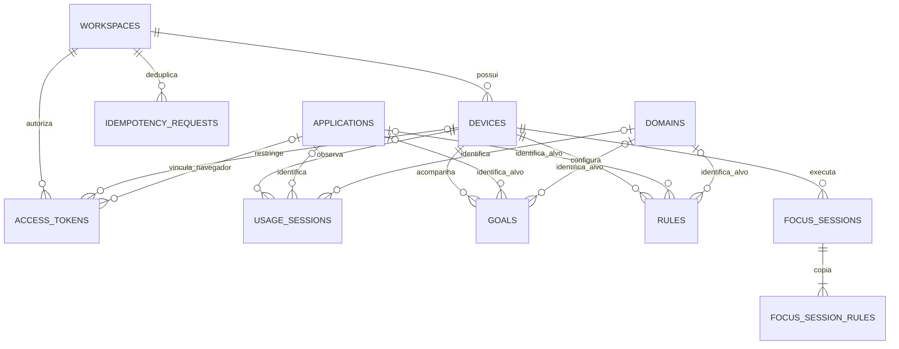

# Modelo de dados e DER

Estado: modelo lógico v1 para uso pessoal, metas e foco. As tabelas, migrações e persistência SQLite estão implementadas; consulte o [guia do banco](storage.md). Os serviços de metas, foco e autenticação ainda não estão implementados. Este é o mapa de entidades do escopo de integração das cinco frentes, não o modelo completo de famílias/equipes. Consulte o [contrato da API](api.md) para as regras de eventos e relatórios.

## Relacionamentos

`rules` reúne listas de bloqueio e permissão pelo campo `action`; duas tabelas duplicariam a estrutura de alvos e propriedade. `usage_sessions` guarda intervalos brutos encerrados, não uma sessão inteira de login nem um total diário calculado. Observações desktop e do navegador ocupam linhas separadas.

Os nomes de entidades e campos ficam em inglês para corresponder ao código e à API. No diagrama, `WORKSPACES` são espaços pessoais; `DEVICES`, dispositivos; `ACCESS_TOKENS`, credenciais de acesso; `USAGE_SESSIONS`, observações de uso; `APPLICATIONS` e `DOMAINS`, aplicativos e domínios; `GOALS`, metas; `RULES`, regras; `FOCUS_SESSIONS`, sessões de foco; `FOCUS_SESSION_RULES`, suas cópias de regras; e `IDEMPOTENCY_REQUESTS`, comprovantes para evitar operações repetidas.

## Dicionário de entidades

IDs são UUIDs em texto, salvo indicação contrária. Horários como `created_at` usam UTC; no SQLite inicial, guardar milissegundos desde a época Unix como inteiros. A API converte para/de textos UTC. Durações são calculadas pelos horários, não gravadas independentemente. `?` indica campo que aceita nulo; os demais são obrigatórios. Habilitar chaves estrangeiras em toda conexão. `PK` significa chave primária; `FK`, chave estrangeira; `UNIQUE`, unicidade.

| Entidade | Campos e chaves |
| --- | --- |
| `workspaces` | `id PK`, `name`, `timezone` (IANA), `retention_days` (inicialmente 90), `created_at` |
| `devices` | `id PK`, `workspace_id FK`, `name`, `platform` (`windows`, `linux`), `ingestion_not_before` (UTC), `created_at`, `revoked_at?` |
| `access_tokens` | `id PK`, `workspace_id FK`, `device_id? FK`, `browser_application_id? FK`, `token_hash UNIQUE`, `client_kind` (`desktop_ui`, `desktop`, `browser`), `created_at`, `expires_at`, `revoked_at?` |
| `applications` | `id PK`, `app_key UNIQUE`, `display_name`, `platform` (`windows`, `linux`) |
| `domains` | `id PK`, `hostname UNIQUE` (domínio ASCII normalizado, com correspondência exata) |
| `usage_sessions` | `id PK` (UUID do servidor), `device_id FK`, `event_id`, `source`, `state`, `application_id? FK`, `domain_id? FK`, `started_at`, `ended_at`, `received_at`, `payload_hash`; `UNIQUE(device_id, event_id)` |
| `goals` | `id PK`, `device_id FK`, `target_type` (`all`, `application`, `domain`), `application_id? FK`, `domain_id? FK`, `period` (`day`, `week`, `month`), `timezone`, `limit_seconds` (>0), `created_at` |
| `rules` | `id PK`, `device_id FK`, `target_type` (`application`, `domain`), `application_id? FK`, `domain_id? FK`, `action` (`block`, `allow`), `created_at` |
| `focus_sessions` | `id PK`, `device_id FK`, `status` (`active`, `completed`, `cancelled`), `started_at`, `scheduled_end_at`, `finished_at?`, `created_at` |
| `focus_session_rules` | `id PK`, `focus_id FK`, `target_type`, `target_key`, `action`; `UNIQUE(focus_id, target_type, target_key)` |
| `idempotency_requests` | `workspace_id FK`, `route`, `key`, `request_hash`, `response_status`, `response_body`, `created_at`, `expires_at`; chave primária composta `(workspace_id, route, key)` |

Aplicativos são identificados pela chave da plataforma, não pelo nome exibido. Dois aplicativos com o mesmo rótulo continuam distintos. Alterar o nome de exibição não muda a identidade do evento. O hash do conteúdo inclui os campos originais normalizados, inclusive o nome enviado; alterações no catálogo não mudam a detecção de duplicatas.

Aplicativos/domínios de metas e regras devem existir no catálogo. A criação usa as chaves de recursos da API e resolve os IDs dentro de uma transação. A plataforma do aplicativo deve ser compatível com o dispositivo em observações, metas e regras. O catálogo pode conter entradas antes de haver observações.

As linhas de `focus_session_rules` copiam chave e ação na criação da sessão, em vez de depender de regras que possam ser alteradas ou excluídas. Cada sessão exige pelo menos uma regra. Alterar/excluir a regra de origem não enfraquece uma sessão já ativa.

## Restrições e transações

- `ended_at > started_at`; duração máxima de 60000 ms. O backend verifica tolerância de horário futuro, retenção, domínio e fuso antes de gravar.
- Desktop ativo exige aplicativo e não tem domínio. Desktop inativo não tem nenhum alvo. Navegador exige domínio, `state=active` e o aplicativo do navegador vinculado ao token. Origem e estado usam valores enumerados fechados.
- Meta com alvo `all` não referencia recurso; `application` referencia apenas aplicativo; `domain`, apenas domínio. Regras usam os dois últimos casos. Usar `CHECK` para consistência de alvo/nulos, enumerações e limites positivos.
- Dispositivo do token do agente/extensão deve pertencer ao espaço indicado no token. Tokens da interface não têm dispositivo restrito; os de agente/navegador exigem dispositivo. `browser_application_id` é obrigatório apenas para tokens `browser` e nulo nos demais; o aplicativo deve corresponder à plataforma do dispositivo. O backend valida esse vínculo ao receber eventos. Verificar propriedade em transação, não só a existência das chaves estrangeiras.
- Para cada `(device, source)`, a condição de sobreposição é `existing.started_at < incoming.ended_at AND existing.ended_at > incoming.started_at`. Verificá-la entre registros persistidos e recebidos na mesma transação de escrita serializada da inserção (`BEGIN IMMEDIATE` no adaptador SQLite inicial). Unicidade sozinha não impede sobreposição temporal.
- Impedir mais de uma sessão `active` por dispositivo com índice único parcial. Reconciliar sessões expiradas na transação de início antes dessa verificação. Sessões concluídas terminam no horário programado; canceladas, no horário do cancelamento; ativas têm `finished_at` nulo.
- Não permitir duas regras do mesmo dispositivo para o mesmo alvo normalizado. Mudar a ação exige excluir/recriar na v1. A unicidade das cópias também impede ações contraditórias na sessão.
- Revogar dispositivo bloqueia imediatamente o recebimento, preservando histórico até exclusão explícita ou expiração. Verificar revogação de tokens a cada requisição.
- Lotes de eventos, criação de foco com cópias e gravação de recursos com comprovantes de idempotência devem ser atômicos. Em falha, desfazer toda a transação.

## Índices implementados

Além dos índices de chave primária e unicidade:

| Índice | Finalidade |
| --- | --- |
| `devices(workspace_id, id)` | Verificar propriedade no espaço pessoal. |
| `usage_sessions(device_id, source, started_at, ended_at)` | Consultas por período e candidatos à sobreposição. |
| `usage_sessions(started_at)` | Limpeza por retenção baseada no início do intervalo. |
| `goals(device_id, created_at, id)` | Paginar metas por cursor. |
| `rules(device_id, created_at, id)` | Paginar regras por cursor. |
| Único `rules(device_id, application_id)` para alvo aplicativo | Uma regra por aplicativo/dispositivo. |
| Único `rules(device_id, domain_id)` para alvo domínio | Uma regra por domínio/dispositivo. |
| `focus_sessions(device_id, created_at, id)` | Paginar histórico de foco. |
| Único `focus_sessions(device_id)` quando o estado é ativo | Uma sessão em execução por dispositivo. |
| `focus_sessions(status, scheduled_end_at)` | Reconciliar expiração. |
| `focus_session_rules(focus_id)` | Ler a cópia imutável das regras. |
| `idempotency_requests(expires_at)` | Excluir comprovantes de reenvio expirados. |

Medir planos de consulta com volume fictício antes de adicionar índices específicos ou totais diários pré-calculados. Os intervalos são a fonte de verdade; a primeira versão não armazena rankings nem progresso de metas derivados.

## Agregação e metas

Para limites `[q_start, q_end)`, selecionar `started_at < q_end AND ended_at > q_start`. O tempo dentro de uma faixa é `max(0, min(ended_at, bucket_end) - max(started_at, bucket_start)) / 1000` segundos. Gerar limites das faixas no fuso IANA solicitado antes de consultar valores UTC. Não agrupar diretamente pela data UTC nem assumir dias de 86400 segundos.

Rankings de aplicativos somam apenas interseções desktop ativas, agrupadas por chave estável. Inatividade usa apenas linhas desktop inativas. Rankings de domínio cruzam navegador e desktop ativo do mesmo dispositivo e aplicativo, e agrupam por domínio. Eventos da extensão enquanto outro aplicativo está em primeiro plano não entram no total do domínio. A ausência de sobreposição dentro de cada origem evita contagem duplicada nas interseções. Lacunas não viram inatividade presumida. Relatórios entre dispositivos ficam fora da v1.

O período de uma meta contém o instante atual do servidor no fuso da meta. Calcular o progresso com as mesmas regras de relatório para o alvo, considerando observações até agora. Retornar `used_seconds`, `remaining_seconds=max(0, limit-used)` e `exceeded=(used > limit)`. Metas não pausam aplicativos nem alteram o recebimento de eventos.

## Migrações, exemplos e exclusão

A camada SQLite inclui migrações ordenadas e tabela `schema_migrations`, com verificação de checksum e aplicação atômica. Cada migração deve usar transação, preservar dados existentes e ser testada a partir de um esquema anterior. A inicialização não pode substituir um banco existente. SQLite é o adaptador local inicial; um futuro adaptador hospedado deve preservar essas garantias e proteger escritas concorrentes de forma equivalente.

Usar o diretório de dados do usuário do sistema, configurável nos testes, nunca o repositório. Os exemplos devem incluir espaço/dispositivo fictícios, uso ativo e inativo, observações do navegador sobrepostas ao desktop, metas e regras/sessões de foco. A carga de exemplos deve ser explícita, determinística e repetível; nunca automática no banco do usuário.

A retenção remove intervalos iniciados antes do corte, inclusive os que o atravessam (perda adicional máxima de 60 segundos), e avança `ingestion_not_before` de cada dispositivo sem retroceder. Rejeitar reenvios anteriores a esse limite, mesmo que o prazo de retenção aumente depois.

A exclusão manual também deve impedir que filas restaurem o histórico. O comando local `delete-history` avança esse corte por dispositivo e exige `--confirm`. Inicializar `devices.ingestion_not_before` no limite de retenção durante o provisionamento. A API rejeita inícios anteriores ao corte. Ainda não há rota HTTP reservada para excluir histórico; administração local e testes de exclusão vêm primeiro.

Excluir dispositivo remove em cascata eventos, tokens, metas, regras e histórico de foco. Excluir foco remove as cópias das regras. Excluir espaço remove dispositivos, tokens do espaço e comprovantes de idempotência. Excluir aplicativo/domínio é proibido enquanto houver referência. Limpar entradas do catálogo sem referências para não deixar metadados de histórico excluído. Revogação e exclusão de dispositivos estão disponíveis no repositório Python. A manutenção local remove entradas do catálogo sem referências. Rotas HTTP e administração de espaços ainda não estão implementadas.

## Limites do escopo

Credenciais de contas, vínculos familiares/de equipe, políticas de responsáveis, exceções, categorias, subgrupos, conquistas e relatórios imutáveis precisam de ampliação específica a partir dos [requisitos](product.md). Não representar famílias/equipes como espaços pessoais v1 nem tratar tokens pessoais como autenticação de múltiplos usuários.
